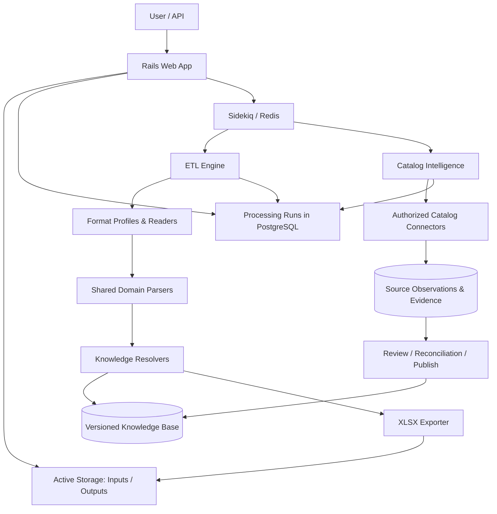

# Automotive Catalog ETL Platform

**Architecture and Implementation Plan**  
**Status:** Proposed baseline  
**Primary stack:** Ruby on Rails, PostgreSQL, Sidekiq, Redis, Active Storage, Roo, rubyXL  
**Scope:** Extensible automotive catalog ingestion, interpretation, enrichment, reconciliation, and deterministic Excel export

> **Current implementation note:** The external catalog research, review, and publish workflow described below has been removed from the application. Workbook processing now extracts candidates and exports immediately. This document remains a historical/proposed architecture reference; it does not describe current runtime behavior. The local vehicle reference catalog and historical run/release data are retained.

## 1. Executive Summary

Build a modular monolith in Ruby on Rails that converts heterogeneous supplier files into a consistent, ACES/PIES-inspired automotive catalog. The system must accept supplier-specific file structures and extraction rules; parse product, vehicle, engine, dimension, and interchange information; enrich missing product facts through authorized manufacturer, distributor, and retailer catalogs; and generate a repeatable normalized XLSX output.

Every processing request is a **persisted, queryable processing run**, executed asynchronously using **Sidekiq**. Users can upload a file, view its status and progress, inspect extracted records and problems, and download the resulting XLSX when processing finishes. Catalog acquisition runs separately from deterministic export: external findings are stored as evidence, reviewed/resolved, and published into versioned knowledge releases.

### Core goals

1. **Extensibility:** adding a supplier format may introduce a detector, reader/mapping rules, custom parsers, overrides, and validation without changing the ETL core.
2. **Reproducibility:** the same input bytes, selected profile version, ruleset version, and immutable knowledge release produce the same logical output.
3. **Fidelity:** validate the output against the supplied `output_prueba.xlsx` example, including the six worksheet contracts, rather than treating the fixture as a hardcoded lookup response.
4. **Observability:** each run is queryable, with state, stage, counts, record-level results, evidence, warnings, errors, and downloadable artifacts.
5. **Data provenance:** no inferred fitment or interchange is silently promoted to verified knowledge; conflicting observations remain traceable.
6. **Pragmatism:** begin as one Rails application with clean module boundaries; avoid microservices, a general-purpose workflow engine, and runtime LLM decisions in the critical path.

## 2. Non-Goals and Constraints

- Do not build a complete replacement for proprietary automotive reference databases in the first release.
- Do not claim full ACES or PIES certification or compliance merely because the internal schema is inspired by them.
- Do not assume VCdb enumerates aftermarket part-to-vehicle fitments. Fitment assertions must come from verified part application data.
- Do not automatically scrape sites whose terms, access controls, or licenses prohibit automated access. Prefer authorized APIs, feeds, downloadable catalogs, or permitted extraction.
- Do not make live external catalog searches part of a reproducible export transaction.
- Do not guarantee perfect reconstruction of unknown products if authoritative specifications and fitments are unavailable. Represent the shortfall transparently.

## 3. System Boundaries



### Module responsibilities

| Module | Owns | Does not own |
|---|---|---|
| Rails application | Authentication (if applicable), uploads, run UI/API, download authorization | Parsing and source-specific logic |
| ETL Core | Run orchestration, execution context, transforms, validation, export contract | External catalog scraping or individual supplier conventions |
| Format Profiles | File recognition, sheets/columns, row mapping, supplier-specific syntax and overrides | Generic automotive knowledge or XLSX layout |
| Domain Engine | Shared extraction, classification, canonical facts/products | File-specific header layout |
| Catalog Intelligence | Source discovery, searching, retrieval, matching, evidence capture | Mutating an active run's knowledge snapshot |
| Knowledge Base | Vehicle/product reference entities, relationships, assertions, versioned releases | Live website interaction |
| Exporters | Deterministic representation of normalized data into a target format | Searching for missing attributes |

## 4. Data Flow and Run Lifecycle

### 4.1 Normal processing

1. User uploads an XLSX/XLS/CSV/XML file; Rails persists it using Active Storage.
2. Create a `ProcessingRun` with UUID, initial `queued` state, input checksum, and requested output format.
3. Enqueue `ProcessCatalogJob` through Sidekiq; return the run identifier immediately.
4. Resolve the supplier format by a deterministic profile registry. If multiple profiles match, fail with an actionable ambiguity or use an explicit user-selected profile.
5. Pin `format_version`, `ruleset_version`, and `knowledge_release_id` for the entire run.
6. Read and map supplier rows into canonical input records while tracking the source sheet and row numbers.
7. Execute common parsers and profile-specific parsers; capture extraction facts and evidence.
8. Normalize brands, product types, engine identifiers, vehicle references, specifications, and interchange candidates using the pinned knowledge release.
9. Resolve known verified applications and interchanges. Record unknown/conflicting cases without fabricating relationships.
10. Persist normalized products and diagnostic findings, including partial results when appropriate.
11. Export the expected worksheets, validate their schemas, attach XLSX to the run, and set `completed` or `completed_with_warnings`.
12. UI/API exposes the run details, record results, warnings, and authorized XLSX download.

### 4.2 Missing knowledge and enrichment

1. An ETL run may create deduplicated `EnrichmentRequest` records for unresolved products or references.
2. During extraction, each persisted product is passed to the brand/category/reference-based source planner and supported research is queued idempotently. `EnrichCatalogJob` remains separate from deterministic export.
3. Connectors return source observations, original identifiers, provenance and fitment/attribute/interchange claims.
4. Matching and evidence validation classify assertions as `verified`, `candidate`, or `conflict` under explicit rules.
5. Authorized observations are promoted to a **new immutable knowledge release**.
6. A new ETL run can use that release. Existing runs remain linked to the previously selected snapshot.

**Important:** A live enrichment request must not alter the knowledge version used by an in-progress export. If a product needs new knowledge, the system can offer an explicit *reprocess with latest knowledge* action.

## 5. Extensible Format Architecture

There are two distinct dimensions of variability:

- **File transport/layout:** XLSX versus CSV, worksheets, header names, merged cells, data row positions.
- **Supplier semantics:** SKU grammar, abbreviations, model/year representations, cross-reference notation, units, category labels and exceptions.

An input profile may define both without duplicating the shared domain parsers.

### Contract

```ruby
module Etl
  module Formats
    class BaseProfile
      def self.detect?(_document_metadata) = raise(NotImplementedError)
      def version = raise(NotImplementedError)
      def each_record(_document, &_block) = raise(NotImplementedError)
      def transforms = []
      def validators = []
    end
  end
end
```

`each_record` yields canonical input objects containing original fields, structured facts if present, free-form descriptions, and source location. A supplier with separate engine/model/measurement columns should preserve those structured facts rather than concatenating everything into prose.

**Resolution order:** explicit profile choice (when supplied) > high-confidence structural detection > deterministic priority > ambiguity error. Do not use arbitrary hash iteration or file names as the only detection signal.

### Extension examples

| New requirement | Add/change | Avoid changing |
|---|---|---|
| Supplier uses different XLSX columns | Format detector/mapper | Core pipeline |
| Supplier uses three sheets for one product | Profile-specific reader/joiner | Canonical output/exporter |
| Supplier uses a different piston dimension syntax | Specialized parser/transform | Other supplier parsers |
| New product family | Domain classifier and family parser | File readers |
| New brand alias | Versioned knowledge data | Parser code |
| New retailer API | Catalog connector + registry configuration | Exporter |
| ACES XML export | New output adapter | Input profiles |

## 6. Domain Model

### Canonical input

```ruby
Catalog::InputRecord = Data.define(
  :source_identifier, :sku, :brand_text, :category_text,
  :description, :structured_fields, :metadata
)
```

### Extraction facts

```ruby
Catalog::Fact = Data.define(
  :type, :value, :raw_value, :source_location,
  :parser_id, :rule_version, :evidence
)
```

### Canonical normalized product

```ruby
Catalog::NormalizedProduct = Data.define(
  :sku, :brand, :category, :description,
  :attributes, :interchanges, :applications,
  :facts, :unresolved
)
```

The collections should use explicit value objects (e.g., `AttributeValue`, `Interchange`, `VehicleApplication`) with stable identifiers and source assertions. `Data.define` is illustrative: persistent entities use Active Record, while parsers should depend primarily on immutable Ruby values or repository interfaces.

### Parsing versus resolution

- **Parser:** recognizes `89X1.2X1.2X2` as diameter 89 mm and ring widths 1.2/1.2/2.0 mm; recognizes `QR25DE` as an engine-code candidate.
- **Classifier:** maps category text, supplier rules and available facts to a product family.
- **Resolver:** links candidates to known brand, engine, vehicle, product category and part-reference entities using the pinned release.
- **Matcher:** establishes whether an external catalog result refers to the same *part variant*, not just a similar engine/product family.
- **Exporter:** serializes the resolved facts and relationships to worksheets.

Unknown values are reported, not silently made up.

## 7. Automotive Knowledge Base (ACES/PIES-Inspired)

Use PostgreSQL with a simplified schema prepared for official external identifiers, source provenance and future imports.

| Area | Suggested tables |
|---|---|
| Product vocabulary | `automotive_brands`, `catalog_product_categories`, `attribute_definitions`, `part_identifiers` |
| Vehicle vocabulary | `vehicle_makes`, `vehicle_models`, `vehicle_configurations`, `vehicle_candidates` |
| Product relationships | `catalog_parts`, `catalog_assertions` (fitment, interchange, attribute and catalog-field assertion types), `related_catalog_part_id` |
| Source evidence | Existing `catalog_observations` plus `catalog_assertions` with source, claim, review value and evidence URL |
| Versioning | Existing immutable `knowledge_releases` plus `knowledge_release_assertions` snapshots; legacy JSON release entries remain supported |

The first normalized schema is deliberately additive and ACES/PIES-inspired: an input part variant is stored with its exact brand/number identity; description vehicles remain `vehicle_candidates`; canonical vehicle configurations can carry optional licensed external IDs; and provider claims remain separate assertions linked to observations. Existing run JSON and releases are not rewritten. The task `automotive_knowledge:backfill` is a separate, idempotent batched conversion for persisted records and observations.

### ACES/PIES references

- **ACES:** application/fitment exchange representation.
- **PIES:** product metadata, descriptions, attributes and commercial product information.
- **VCdb:** vehicle configuration reference identifiers and relationships.
- **PCdb:** standardized product taxonomy.
- **PAdb:** product attribute definitions and applicability.
- **Qdb:** qualifiers for vehicle applications.
- **Brand reference data:** normalized brand identities.

Keep `external_source`, `external_id`, `source_version`, and effective dates in imported entities when available. Official datasets may be licensed; document availability, permission and access limitations. **Do not equate VCdb vehicle configurations with verified part fitment.**

### Evidence rules

- Distinguish exact same-brand part aliases, interchange claims and direct part-to-vehicle fitments.
- Preserve dimensions and suffix variants (e.g., `STD`, `+20`) during identity matching.
- Do not automatically infer transitive interchange or fitment equivalence.
- Keep conflicting assertions independently; resolve only under explicit policy.
- Publish approved data into an immutable release; do not retroactively mutate previous releases.

## 8. Catalog Intelligence Service

### Responsibilities

1. Given a `ProductQuery`, select candidate sources by brand, product category, region/market and supported capability.
2. Search first by exact brand + part number, then alternate/known reference numbers, OEM number, engine/category, and vehicle context when supported.
3. Retrieve product details and parse attributes, interchanges and fitments.
4. Validate identity and variant against existing product facts.
5. Store raw/normalized observations and their provenance.
6. Reconcile and publish approved knowledge; send unresolved/conflicting claims for review.

### Connectors

Each connector specifies capabilities such as `part_lookup`, `cross_reference`, `attributes`, `fitments`, and `oem_lookup`, alongside permitted transport (`api`, `feed`, `download`, `permitted_html`). Coverage can be configured with `source_brand_rules` and category/market priorities.

```ruby
module CatalogIntelligence
  class BaseConnector
    def supports?(brand:, category:, capability:) = raise(NotImplementedError)
    def search(query:) = raise(NotImplementedError)
    def fetch_product(identifier:) = raise(NotImplementedError)
  end
end
```

**Source candidates to investigate, not assumed available APIs:** authorized manufacturer catalogs (MAHLE, Hastings, Continental, etc.), distributor feeds, licensed TecDoc access, OEM part catalogs and retailers that permit programmatic collection. Respect permissions, rate limits, robots/site policies where applicable, contractual access and data licenses. No captcha bypass or access-control circumvention.

### Matching policy

Score evidence based on brand, exact part reference, aliases, product category, variant/suffix, measurements and application constraints. Define hard contradiction rules (e.g., incompatible oversize). A score alone should not publish a verified fitment. Classify claims as `verified`, `candidate` or `conflict`, and record why.

## 9. Sidekiq Background Processing

**Decision:** All asynchronous jobs run through **Sidekiq with Redis**. Do not use Solid Queue for this project.

### Jobs

| Job | Queue | Purpose |
|---|---|---|
| `ProcessCatalogJob` | `etl` | Detect/read/parse/resolve/validate/export an uploaded file |
| `EnrichCatalogJob` | `enrichment` | Investigate a product or group of unresolved references |
| `ImportKnowledgeJob` | `imports` | Ingest an authorized reference catalog/feed |
| `PublishKnowledgeReleaseJob` | `maintenance` | Validate and publish a versioned knowledge snapshot |
| `CompareGoldenOutputJob` | `validation` | Diff a generated output against a stored golden fixture |

Configure queue priorities, concurrency and per-source request limits based on workload. Use Active Job's Sidekiq adapter or native Sidekiq workers consistently; the initial implementation can use Active Job with `:sidekiq` for Rails integration.

### Reliability requirements

- **Persisted states are authoritative:** Sidekiq job status is not the user-facing source of truth.
- Jobs are **idempotent** for a given run and stage; use stable idempotency keys and uniqueness/locking where appropriate.
- Do not run two active processors against the same `ProcessingRun`; acquire a database-level or reliable distributed lock.
- Record attempts, started/finished timestamps and failure details.
- Advance stages transactionally; retry transient failures with capped exponential backoff and jitter.
- Mark permanent schema errors as failed without pointless retries.
- Do not report `completed` until the output attachment and output manifest are persisted.
- Store checkpoints/record progress for large inputs; design resumable stages where practical.
- Support cancellation as a requested state checked at safe checkpoints (do not assume force-killing a worker is transactional).
- Give enrichment jobs lower priority than interactive ETL runs when capacity is limited.
- Protect Sidekiq Web UI with authentication and authorization if enabled.

### Proposed state machine

```text
queued -> detecting -> reading -> extracting -> resolving
       -> validating -> exporting -> completed

Any active state -> failed
Any active state -> cancel_requested -> canceled
Export success with nonfatal unresolved findings -> completed_with_warnings
```

Retries may re-enter a previous stage but must not duplicate products, observations, artifacts or counters. User-facing `stage` and `status` can be modeled separately to simplify transitions.

## 10. Processing Runs: Persistence, Querying, Results and Downloads

### Tables

**`processing_runs`**

| Column | Purpose |
|---|---|
| `id` (UUID) | Public run identifier |
| `status`, `stage` | State machine and current phase |
| `format_key`, `format_version` | Selected input profile |
| `ruleset_version` | Pinned extraction logic |
| `knowledge_release_id` | Pinned knowledge snapshot |
| `export_schema_version` | Pinned XLSX contract |
| `input_sha256` | Input identity/checksum |
| `total_records`, `processed_records` | Counts for progress |
| `successful_records`, `warning_records`, `failed_records` | Outcome counts |
| `progress_percent` | Approximate, monotonic progress |
| `attempt_count`, `last_error_code`, `last_error_message` | Debugging and retries |
| `started_at`, `finished_at` | Timing |
| `requested_by_id` | Ownership/authorization, if applicable |
| `metadata` (JSONB) | Supplemental run information |

Use Active Storage attachments for `input_file`, `output_file`, and optionally `comparison_report` and `error_report`.

**`processing_records`**

- `id`, `processing_run_id`, `source_sheet`, `source_row`, `source_sku`
- `status`, `normalized_product` (JSONB or normalized associations), `facts`, `unresolved`
- `warnings_count`, `errors_count`, `processed_at`

**`processing_issues`**

- `processing_run_id`, `processing_record_id` (nullable), `stage`, `severity`, `code`, `message`, `details` (JSONB), `source_location`

**`processing_artifacts`** (optional if multiple generated artifacts)

- `processing_run_id`, `kind`, Active Storage attachment, `checksum`, `export_schema_version`, `created_at`

**`enrichment_requests`**

- Link to product/reference and optionally initiating run; `status`, `query_fingerprint`, source plan, results/issue summary.

### API contract

| Method | Endpoint | Behavior |
|---|---|---|
| `POST` | `/api/v1/processing_runs` | Upload input, optionally specify format, enqueue Sidekiq job, return `202 Accepted` + UUID |
| `GET` | `/api/v1/processing_runs` | Paginated run list and filters by status/date/format |
| `GET` | `/api/v1/processing_runs/:id` | Status, stage, progress, versions, counts, timestamps, artifact availability |
| `GET` | `/api/v1/processing_runs/:id/records` | Paginated per-record results and filters |
| `GET` | `/api/v1/processing_runs/:id/records/:record_id` | Product details, extracted facts, normalized values and evidence |
| `GET` | `/api/v1/processing_runs/:id/issues` | Warnings/errors by severity, record and stage |
| `GET` | `/api/v1/processing_runs/:id/download` | Authenticated redirect/stream to stored XLSX, only when available |
| `GET` | `/api/v1/processing_runs/:id/comparison` | Golden fixture comparison status and diff, if requested |
| `POST` | `/api/v1/processing_runs/:id/reprocess` | Create a **new** run pinned to requested/latest knowledge (do not mutate prior result) |
| `POST` | `/api/v1/processing_runs/:id/cancel` | Request safe cancellation |

A sample status payload:

```json
{
  "id": "7d70733f-0a6d-42b3-9b77-c21038dccdf8",
  "status": "extracting",
  "stage": "parsing_products",
  "progress_percent": 60,
  "records": { "total": 5, "processed": 3, "successful": 2, "warnings": 1, "failed": 0 },
  "format": { "key": "sample_supplier", "version": "1.0.0" },
  "knowledge_release": "2026-11-v1",
  "download_available": false
}
```

### Minimal UI

- **Runs index:** status, uploaded filename, created time, progress, completed time, download action.
- **Run detail:** stage/progress, source format, pinned versions, record counts, warnings/errors, timestamps and retry/cancellation outcomes.
- **Results view:** paginated products with category, SKU, attributes, interchanges, fitments and unresolved claims; inspect extraction evidence for each field.
- **Artifacts:** download XLSX and optional error/diff reports; disallow download until finalized.
- **Reprocess action:** creates a new historical run with selected rule/knowledge versions; retains the original for audit.

Start with GET polling every few seconds, with backoff and terminal-state stop; add Turbo Streams or SSE only if needed. Enforce run ownership/role checks on every endpoint and download; do not expose raw public blob links indefinitely.

## 11. XLSX Output Contract and Golden Validation

Treat `output_prueba.xlsx` as the reference example and `input_prueba.xlsx` as a separate unseen-format/generalization fixture. The target workbook has six sheets:

1. `Origen`
2. `Métricas`
3. `Aplicaciones`
4. `Intercambios`
5. `Atributos`
6. `Catálogo`

Use `lib/catalog/output_template.xlsx` as the authoritative output workbook. Pin its SHA-256 and verify its sheet names, headers, formulas, merged ranges and filters before populating it. Preserve the six-sheet contract and template styles; resize existing filter ranges to include the header and actual output rows. Do not assume that the ten reference products and five independent input products have the same identities.

Golden tests should compare:

- Workbook schema, sheet presence, column labels and required value types.
- Logical rows and relationships per product (preserve legitimate duplicates).
- Normalized category, brand, attributes, interchanges and fitments.
- Aggregate and per-product row counts; computed metrics.
- Sorting and stable export ordering.
- Formatting where part of the contract (number formats, headers and worksheet names).

Separate **logical equality** from **binary XLSX equality**: ZIP entry ordering, workbook metadata and timestamps can differ. Only promise byte-identical exports if these are explicitly canonicalized and tested.

For each golden diff, report missing, unexpected and differing records with source SKU, sheet, key and expected/actual values. Add perturbation tests (whitespace, capitalization, equivalent supplier layouts, SKU changes) to detect hardcoded responses.

## 12. Suggested Rails Project Layout

```text
app/
  controllers/
    api/v1/processing_runs_controller.rb
    api/v1/processing_records_controller.rb
  jobs/
    process_catalog_job.rb
    enrich_catalog_job.rb
    import_knowledge_job.rb
    publish_knowledge_release_job.rb
    compare_golden_output_job.rb
  models/
    processing_run.rb
    processing_record.rb
    processing_issue.rb
    enrichment_request.rb
    catalog_source.rb
    catalog_observation.rb
    knowledge_release.rb
    ...
  services/
    etl/
      pipeline.rb
      execution_context.rb
      format_registry.rb
      readers/
      formats/
        sample_supplier/
          profile.rb
          detector.rb
          mapper.rb
          parsers/
          rules/
      transforms/
      exporters/
    automotive/
      domain/
        input_record.rb
        fact.rb
        normalized_product.rb
      parsers/
        engine_parser.rb
        vehicle_parser.rb
        reference_parser.rb
        ring_dimensions_parser.rb
      classifiers/
      resolvers/
      repositories/
    catalog_intelligence/
      source_registry.rb
      search_planner.rb
      orchestrator.rb
      connectors/
      extractors/
      matching/
      validation/
      publishing/
    quality/
      golden_comparator.rb
  views/
    processing_runs/
      index.html.erb
      show.html.erb
      ...
config/
  sidekiq.yml
spec/
  fixtures/files/
    input_prueba.xlsx
    output_prueba.xlsx
  services/
  requests/
  jobs/
```

Consider `app/lib` or `lib/` for truly framework-independent domain code if it improves dependency boundaries; prefer a consistent Rails autoloading approach.

## 13. Delivery Roadmap

### M0 — Reference analysis and contracts

- Inspect all columns/sheets and join reference rows by product identity.
- Document extraction patterns, unresolved fields and source hypotheses.
- Create golden fixtures, expected canonical objects and exact comparison rules.
- Define run schema and output contract.

**Exit:** field-level reference specification and executable golden test scaffolding.

### M1 — Runnable vertical slice + persistent tracking

- Rails app, PostgreSQL, Redis, Sidekiq, Active Storage.
- `ProcessingRun` state machine, API upload/status/download.
- XLSX reader, first profile, basic parser and exporter.
- Sidekiq job processes one product family and attaches an XLSX.
- Basic run index/detail UI.

**Exit:** upload → enqueue → inspect status/results → download XLSX works end-to-end.

### M2 — Shared extraction and supplier extensibility

- Introduce canonical facts and domain parsers: brand/category, engine, years, references, ring/piston dimensions.
- Add profile-specific transforms and validation.
- Introduce second fixture profile with different source layout to prove isolation.
- Add per-record issues and provenance.

**Exit:** two formats execute via the same core with no supplier conditionals in shared pipeline.

### M3 — Knowledge Base and deterministic resolution

- Product/vehicle vocabulary, aliases, reference and fitment relationships.
- Repositories and snapshot versioning.
- Attribute, interchange and application resolvers.
- Golden comparison and mismatch report.

**Exit:** known dataset is reproducible under a pinned knowledge release; gaps and mismatches are explicit.

### M4 — Catalog Intelligence (first source)

- Source registry, brand/category routing and prioritized search planner.
- One **authorized** catalog connector (API, feed or permitted HTML), source observation storage, matching and conflict reporting.
- Sidekiq enrichment job, source limits, deduplication and retries.
- Publish new immutable knowledge release and reprocess to test impact.

**Exit:** an unresolved part can be researched, its findings audited/published, and a new deterministic run produced.

### M5 — Harden and expand

- Additional sources driven by coverage gaps.
- Ingestion of authorized ACES/PIES-related datasets if accessible.
- Batch performance, streaming/memory tests, job resilience, source fault isolation, security and monitoring.
- Full regression on reference workbook and unseen input.

**Exit:** reliable operation for realistic file sizes with documented limitations and provenance.

## 14. Test Strategy

| Layer | Tests |
|---|---|
| Format detectors | Correct identification; ambiguity handling; malformed sheets |
| Format mappers | Preserve structured columns and source locations |
| Domain parsers | Positive/negative patterns; dimensions, motors, years, references and aliases |
| Resolvers | Known/unknown/ambiguous entities; stable tie-break; variant matching |
| Knowledge release | Immutability; same-release reproducibility; changed-release differences |
| Catalog connectors | Contract tests with captured permitted fixtures; failure handling; parsing drift |
| Sidekiq jobs | Idempotency, retries, duplicate prevention, state transitions, cancel, attachment finalization |
| API/UI | Authz, upload validation, progress, pagination, record detail, download restrictions |
| Excel exporter | Six sheets, schema, types, deterministic sorting, correct metrics |
| Golden integration | Actual versus expected normalized workbook; structured diffs |
| Performance | Large file behavior, memory ceilings, batching, query and job throughput |

Use RSpec and factory/fixture builders. Test network connector behavior with stubs or recordings; integration tests must not rely on a live retailer endpoint. Prefer fixed-time/seeded fixtures for determinism.

## 15. Observability and Operational Concerns

- Structured logs with `processing_run_id`, `processing_record_id`, `job_id`, `source_id`, and `knowledge_release_id`.
- Counters/timing: rows read, parsed, resolved, exported; warnings/errors; connector requests, rate limits, matching outcomes.
- Expose meaningful processing stage and monotonically non-decreasing progress; progress is an estimate for stages with unknown workload.
- Use database indexes on run ID, status/timestamps, normalized part references and source query fingerprints.
- Batch database writes and avoid loading whole workbooks into memory when possible; XLSX export may still require deliberate memory management.
- Constrain file size, extensions/MIME, ZIP-bomb risks and spreadsheet formula injection; sanitize output strings that could become formulas.
- Secure Active Storage and source credentials; set artifact retention and delete policies explicitly.
- Monitor Sidekiq queue latency, dead jobs, Redis health and long-running workers.

## 16. Risks and Mitigations

| Risk | Mitigation |
|---|---|
| Licensed ACES/PIES reference data unavailable | Use compliant conceptual model and explicitly sourced test subsets; design import adapters for later licensing |
| Fitment unavailable from input | Preserve unresolved state, query authorized part-level catalog sources, never invent verified applications |
| Alternate SKUs map to different variants | Keep suffix/brand/measurements and negative match conditions; require variant validation |
| Retail catalog differs from reference output | Store source-specific assertions; pin release and scope/market policy; compare differences rather than merging blindly |
| Websites change or block extraction | Prefer APIs/feeds, honor terms, isolate connectors, capture parsing failures and avoid browser bypass |
| External enrichment causes nondeterminism | Separate research/publish from export; use immutable knowledge snapshots |
| Sidekiq retries duplicate records | Idempotency keys, uniqueness constraints, transactional state/checkpoints |
| Many profiles produce duplicated logic | Shared fact model and domain parsers; compose specialized behaviors instead of vendor conditionals in core |
| Golden tests tempt SKU hardcoding | Test perturbed descriptions, new SKUs and a second supplier format; disallow fixture-only production branches |

## 17. Acceptance Criteria

**Functional**

- Upload a supplier workbook and receive a persistent UUID immediately.
- Process asynchronously via Sidekiq (Redis-backed), not an inline HTTP request or Solid Queue.
- Query any authorized run by UUID while queued, running, completed or failed.
- Inspect run status/stage/progress, counts, warnings/errors, parsed products and source evidence.
- Download the generated XLSX after successful finalization.
- Produce the six-sheet output contract from the supplied example.
- Preserve previous runs and their results after reprocessing.

**Architecture**

- New supplier format can implement distinct layout, parsers, transformations and validations without changes to the core ETL engine.
- New catalog source can be added and selected by brand/category/capability without modifying domain parsers.
- No live source network call is necessary to reproduce a completed run with the same pinned versions.
- Verified relationships and unresolved/candidate assertions remain distinguishable.

**Quality**

- Golden diff identifies every missing, extra or mismatched logical field/record in the reference example.
- Repeat execution with identical input/profile/rules/knowledge produces the same logical workbook.
- Retry, failure and cancellation scenarios leave coherent persisted run state.
- APIs and artifact downloads enforce authorization and avoid exposing another user's files.

## 18. Immediate Next Steps

1. Extract an authoritative sheet/column specification and representative product cases from `output_prueba.xlsx`.
2. Implement Rails + Sidekiq/Redis + Active Storage + the processing-run persistence and API first; prove upload/status/download in a vertical slice.
3. Write the first format profile and reusable parsing components guided by the reference products.
4. Define the knowledge snapshot and evidence contracts before introducing network connectors.
5. Choose one authorized catalog source based on coverage of the sample brands and validate its value with an end-to-end enrichment case.
6. Add a second structurally different input profile to test real extensibility.

---

**Key architectural invariant:** *Catalog Intelligence expands the available verified knowledge; the ETL consumes a pinned, immutable version of that knowledge to produce a traceable and reproducible output. Sidekiq executes the asynchronous work, while Rails persists and exposes every processing run and its downloadable artifacts.*
